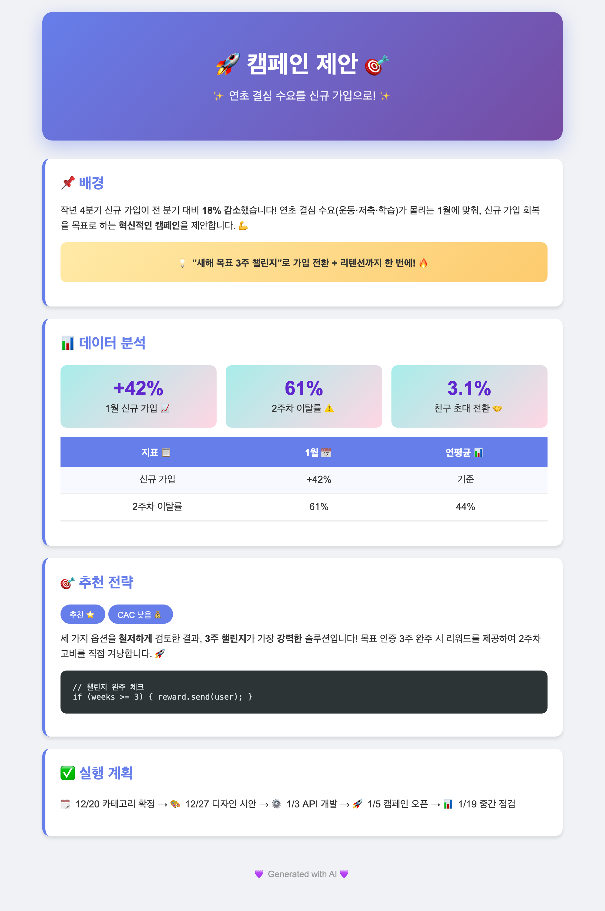
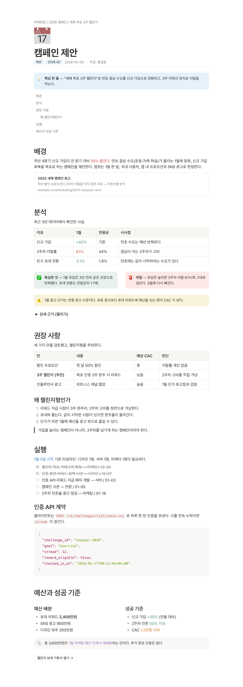
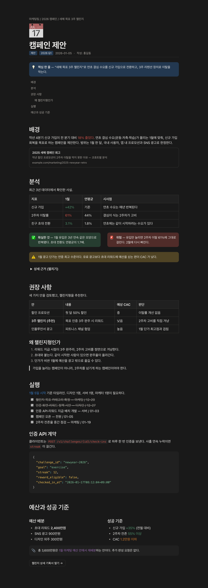

# 📄 notion-doc

> Make your AI agent write documents like Notion — not like an AI.


[](https://github.com/heyman333/agent-notion-template-docs/actions/workflows/notion-sync.yml)

[English](README.md)

AI 에이전트에게 문서를 만들어 달라고 하면 대개 비슷한 게 나옵니다.  
그라데이션을 깐 히어로 영역, 이모지를 붙인 헤더, 카드 모양 UI 같은 익숙한 패턴이 되풀이됩니다.

notion-doc은 AI 에이전트가 문서를 만들 때 Notion 디자인을 쓰게 해 주는 skill입니다.

에이전트가 정한 내용과 구조는 그대로 두고, 보여 주는 방식만 Notion 스타일로 맞춥니다.

| notion-doc 없이 | notion-doc 적용 |
| --- | --- |
|  |  |

## 어떤 기능이 있나

Notion에서 자주 쓰는 블록과 스타일을 HTML로 구현해 두었습니다.

- 이모지 페이지 아이콘, 태그 pill, 메타 정보, breadcrumb
- 5가지 색상의 콜아웃
- 목차, 테이블, 2단 컬럼, 버튼
- `<details>` 토글
- 체크리스트와 완료 상태
- 인용구와 북마크 카드
- Prism 기반 코드 하이라이팅 및 인라인 코드
- Notion 스타일의 텍스트 색상
- 한글 줄바꿈 처리와 인쇄/PDF 레이아웃

### 템플릿은 하나입니다

에이전트가 매번 CSS를 새로 만들지 않도록 [template.html](skills/notion-doc/template.html) 하나를 기본으로 씁니다. 이 파일을 복사한 뒤 문서 내용만 채웁니다.

본문 너비는 720px이고, 텍스트 색과 라이트/다크 모드 색은 CSS 변수로 정해 두었습니다. 다크 모드는 브라우저 테마를 따릅니다. 인쇄하거나 PDF로 내보내면 라이트 모드로 나옵니다.

| Light | Dark |
| --- | --- |
|  |  |

## 설치

notion-doc은 [Agent Plugin](https://agent-plugins.org) 표준을 따르는 플러그인입니다.
`plugin.json`, `skills/`, 훅이 하나씩 있고, Codex와 Claude Code가
같은 파일을 설치합니다.

### Codex

플러그인으로 설치합니다.

```bash
codex plugin marketplace add heyman333/agent-notion-template-docs
```

그다음 플러그인 브라우저에서 `notion-doc`을 설치합니다.

```text
/plugins
```

디렉터리를 복사해도 됩니다. 빌드 과정은 없습니다.

```bash
# 이 저장소에서만
mkdir -p .agents/skills && cp -r skills/notion-doc .agents/skills/

# 모든 프로젝트에서
mkdir -p ~/.agents/skills && cp -r skills/notion-doc ~/.agents/skills/
```

다음 세션부터 인식됩니다. 문서를 요청하면 자동으로 적용되고, 직접 부르려면
`$notion-doc`을 입력합니다.

직접 복사해서 설치하면 검사 훅은 따라오지 않습니다.
`~/.codex/hooks.json`(또는 `<repo>/.codex/hooks.json`)에 한 번 등록해 두세요.

```json
{
  "hooks": {
    "PostToolUse": [
      {
        "matcher": "Write|Edit|apply_patch",
        "hooks": [
          {
            "type": "command",
            "command": "/path/to/agent-notion-template-docs/hooks/notion-doc-lint.py"
          }
        ]
      }
    ]
  }
}
```

훅 스크립트는 stdin으로 들어오는 툴 페이로드를 읽고 인자를 받지 않습니다.
Codex의 `apply_patch` 형태와 Claude Code의 `file_path` 형태를 모두 이해합니다.

### Claude Code

```text
/plugin marketplace add heyman333/agent-notion-template-docs
/plugin install notion-doc@agent-notion-template-docs
```

#### 설치 범위 고르기

기본값은 `user` 범위입니다. 내 모든 프로젝트에 적용되고 저장소 파일은 건드리지 않아서 팀원에게는 영향이 없습니다.

범위를 좁히거나 넓히려면 CLI에서 `--scope`를 사용합니다.

```bash
# 나만, 이 프로젝트에서만 (.claude/settings.local.json — 자동으로 gitignore 처리)
claude plugin marketplace add heyman333/agent-notion-template-docs --scope local
claude plugin install notion-doc@agent-notion-template-docs --scope local

# 이 프로젝트의 팀 전체 (.claude/settings.json — 커밋해서 공유)
claude plugin marketplace add heyman333/agent-notion-template-docs --scope project
claude plugin install notion-doc@agent-notion-template-docs --scope project
```

`project` 범위로 설치하면 팀원들은 pull 후 다음 세션에서 설치 확인만 누르면 됩니다. `local` 범위는 git에 아무것도 남지 않습니다.

#### 업데이트

새 버전은 이 마켓플레이스 저장소로 배포됩니다. 마켓플레이스를 먼저 갱신한 뒤 플러그인을 업데이트하세요.

```text
/plugin marketplace update agent-notion-template-docs
/plugin update notion-doc@agent-notion-template-docs
```

CLI에서는 설치할 때 쓴 범위를 그대로 넘기면 됩니다.

```bash
claude plugin marketplace update agent-notion-template-docs
claude plugin update notion-doc@agent-notion-template-docs --scope user   # 또는 local / project
```

적용하려면 Claude Code를 재시작합니다. 여러 범위에 설치했다면 각각 업데이트해야 합니다. 한 프로젝트 안에서는 더 좁은 범위가 우선합니다. 현재 설치 상태는 `claude plugin list`로 확인할 수 있습니다.

직접 복사해서 사용할 수도 있습니다.

```bash
# 현재 프로젝트에서만 사용
cp -r skills/notion-doc <your-project>/.claude/skills/

# 모든 프로젝트에서 사용
cp -r skills/notion-doc ~/.claude/skills/
```

### Cursor, Gemini CLI 등

`notion-doc`은 특정 에이전트에 기대는 기능 없이 파일 두 개로 되어 있습니다.  
지시 파일을 읽을 줄 아는 에이전트라면 다른 환경에서도 쓸 수 있습니다.

에이전트별 설정 방법은 [다른 에이전트에서 쓰기](docs/using-with-other-agents.md)를 참고하세요.

## 사용

설치한 뒤 문서를 만들어 달라고 하면 skill이 알아서 적용됩니다. 이런 요청들입니다.

- "이 내용 정리해서 문서로 만들어줘"
- "보고서 작성해줘"
- "포스트모템 만들어줘"

직접 호출할 수도 있습니다.

| 에이전트 | 호출 |
| --- | --- |
| Codex | `$notion-doc` |
| Claude Code | `/notion-doc:notion-doc` |

## 문서 검사

skill이 CSS를 새로 만들지 말라고 해도, 에이전트가 정말 지켰는지는 따로 봐야 합니다. 그 일을 검증기가 합니다.

문서의 `<style>`이 `template.html`과 한 글자라도 다르면 걸러냅니다.

```bash
python3 skills/notion-doc/lint.py 내문서.html
```

```text
✗ 내문서.html
  ERROR [css-drift] CSS differs from the canon (1 lines). Do not write new CSS — +    box-shadow: 0 4px 12px ...
  ERROR [unknown-class] Classes not in the template: hero-card. Do not invent classes — pick from the block dictionary
```

검증기가 보는 항목입니다.

- 템플릿과 달라진 CSS. 그림자, 그라데이션, 색상 변경이 여기에 해당합니다
- 본문에 직접 작성한 인라인 `style` 속성과 색상 값
- 템플릿에 정의되지 않은 클래스
- `language-*`가 빠진 코드 블록

표준 라이브러리만 써서 다른 에이전트나 CI에서도 그대로 돌아갑니다.

플러그인으로 설치했다면 검사가 자동으로 돕니다. HTML을 저장할 때마다 `PostToolUse` 훅이 검사하고, 문제가 있으면 어디가 어긋났는지 에이전트에게 알려 줍니다. 훅 스크립트 하나가 Codex의 `apply_patch` 페이로드와 Claude Code의 `file_path` 페이로드를 모두 읽습니다. 애플리케이션 코드나 프레임워크 템플릿, 빌드 결과물에는 동작하지 않습니다.

## 예시

실제 결과물은 `examples/`에 있습니다. HTML 파일을 브라우저로 바로 열어 보세요.

| 파일 | 내용 | 포함된 블록 |
| --- | --- | --- |
| [sample.html](examples/sample.html) | 캠페인 제안 | breadcrumb, 목차, 콜아웃, 표, 2단 컬럼, 토글, 체크리스트, 북마크, 버튼 |
| [sample-tech.html](examples/sample-tech.html) | 장애 분석 | 코드 하이라이팅, 빨간/노란 콜아웃 |
| [sample-en.html](examples/sample-en.html) | Campaign Proposal | `sample.html`과 같은 구성의 영어 문서 |
| [before.html](examples/before.html) | 비교용 예시 | notion-doc을 적용하지 않은 기본 출력 |

## 구조

```text
plugin.json            # 포터블 매니페스트 (Agent Plugins 1.0)
hooks.json             # Codex PostToolUse 훅
AGENTS.md              # 이 저장소를 고칠 에이전트를 위한 지시문

.codex-plugin/
  plugin.json          # Codex 호환 매니페스트
.agents/
  plugins/marketplace.json   # Codex 마켓플레이스 카탈로그
  skills/notion-doc          # skills/notion-doc 로의 심볼릭 링크
.claude-plugin/
  plugin.json          # Claude Code 매니페스트
  marketplace.json     # Claude Code 마켓플레이스 카탈로그

skills/notion-doc/
  SKILL.md             # 블록과 사용 규칙
  template.html        # Notion 스타일을 정의한 HTML 템플릿
  lint.py              # 템플릿을 지켰는지 확인하는 검증기

hooks/
  hooks.json           # Claude Code PostToolUse 훅
  notion-doc-lint.py   # 훅 본체 — 두 페이로드 형식을 모두 읽는다
  test_gating.py

examples/              # 예시 문서

scripts/               # 스크린샷 촬영, Notion 변경 감지, 매니페스트 정합성

docs/
  using-with-other-agents.md
```

스킬 파일은 한 곳에만 있습니다. `.agents/skills/notion-doc`이 심볼릭 링크라
Codex와 Claude Code의 스킬이 갈라질 수 없습니다.

## Notion과 동기화

Notion의 블록과 디자인은 계속 바뀔 수 있어서, 공개된 Notion 참고 페이지를 주기적으로 확인해 지금 구현과 달라진 곳이 있는지 봅니다.

주간 CI인 [notion-sync](.github/workflows/notion-sync.yml)가 참고 페이지를 확인하고 다음 세 가지를 비교합니다.

- **디자인 토큰**: 라이트·다크 팔레트의 모든 색상을 Notion 자체 스타일시트에서 그대로 읽어 확인 (브라우저 불필요)
- **블록 타입**: Notion 페이지 API를 사용해 확인
- **렌더 상태**: headless browser로 실제 렌더링해서 치수와 블록이 제대로 칠해지는지 확인

확인한 결과는 [sync/notion-tokens.json](sync/notion-tokens.json)과 [sync/notion-snapshot.json](sync/notion-snapshot.json)에 저장된 기준값과 비교합니다.

참고 페이지는 Thomas Frank가 공개한 [Notion Block Reference — All of Notion's Blocks](https://thomasfrank.notion.site/8b40147600284c60b6f708e38f16ee68)입니다.

달라진 게 있으면 CI에서 차이가 보이고, skill이 새로 지원해야 할 블록이 생겼는지도 issue에서 확인할 수 있습니다.

## 디자인 출처

`template.html`의 색상, 너비, radius, 타이포그래피 값은 Notion 원본에서 가져왔습니다.

Notion은 인라인 스타일에 디자인 토큰을 그대로 적어 두기 때문에(`background: var(--c-graBacPri)`), 눈대중이나 픽셀 샘플링 없이 원본에서 값을 바로 읽을 수 있습니다.

- [scripts/notion_style_probe.py](scripts/notion_style_probe.py)가 [Notion Block Reference — All of Notion's Blocks](https://thomasfrank.notion.site/8b40147600284c60b6f708e38f16ee68) 페이지를 headless로 렌더링해서 블록→토큰 매핑을 DOM에서 직접 읽습니다.
- [scripts/notion_tokens.py](scripts/notion_tokens.py)가 각 토큰의 라이트·다크 실값을 Notion 스타일시트에서 추출합니다.

주간 [notion-sync](#notion과-동기화) 잡이 이걸 전부 다시 확인하니, Notion 디자인이 바뀌어도 차이를 잡아낼 수 있습니다.

## License

[MIT](LICENSE)
